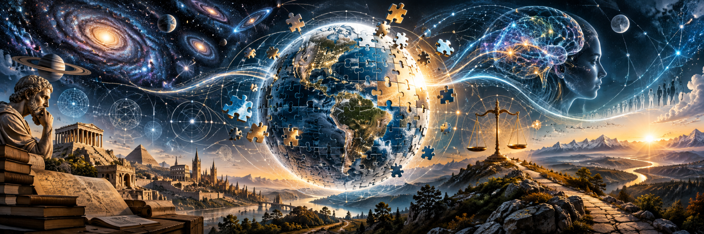

<h1 align="center">The Ultimate Justified Worldview Project (UJW)</h1>

  

<strong><a href="LIVING_WORLDVIEW.md">Current UJW Synthesis →</a></strong>

<strong><a href="OFFICIAL_AI_AUDITOR_PROMPT.md">Official AI Auditor Prompt →</a></strong>

<a href="AUDITOR_PROMPT_ONLY.txt">Prompt text only (easier to select on mobile)</a>

**An open, ongoing effort to discover and refine the most justified understanding of reality possible.**

We do not start by declaring any religion, naturalistic theory, philosophy, or comprehensive worldview to be the answer. Instead, we examine clear claims and the reasons for believing or questioning them. Our methods are also open to challenge. We can make progress without pretending that every mystery has been solved.

## A living puzzle

Imagine assembling a puzzle without knowing every piece or even the final picture. New evidence may reveal a piece, change what it seems to show, or force us to redraw part of the picture. An idea does not enter our evolving worldview just because it fits a nice story. It needs enough independent support for its precise claim, and we record objections and uncertainty.

## Six questions anyone can explore

1. [What can we know, and how can we know it?](https://github.com/kenkibbey/Ultimate_Justified_Worldview/issues/new?template=02-knowledge-method.yml)
2. [What is reality, and why, if anything, does it exist?](https://github.com/kenkibbey/Ultimate_Justified_Worldview/issues/new?template=03-reality-existence.yml)
3. [What are we, and how did we come to exist?](https://github.com/kenkibbey/Ultimate_Justified_Worldview/issues/new?template=04-human-consciousness.yml)
4. [What, if anything, gives life meaning or purpose?](https://github.com/kenkibbey/Ultimate_Justified_Worldview/issues/new?template=05-meaning-purpose.yml)
5. [How should we live, and why?](https://github.com/kenkibbey/Ultimate_Justified_Worldview/issues/new?template=06-morality-action.yml)
6. [What, if anything, happens after death?](https://github.com/kenkibbey/Ultimate_Justified_Worldview/issues/new?template=07-death-destiny.yml)

**[Challenge UJW as a whole](https://github.com/kenkibbey/Ultimate_Justified_Worldview/issues/new?template=01-whole-project.yml)** — question our foundations, fairness, reasoning, governance, evidence rules, priorities, or any conclusions. Nothing is exempt.

**[Suggest other evidence, an alternative worldview, or a missing question](https://github.com/kenkibbey/Ultimate_Justified_Worldview/issues/new?template=08-other-evidence.yml)**.

## How we reach findings

Read [our research method](METHOD_AND_FAIRNESS.md), [evidence standards](EVIDENCE_STANDARDS.md), and [challenge process](CHALLENGE_PROCESS.md). For every actual finding we aim to show the exact claim, strongest supporting evidence and objections, scope, reasoning, confidence, dependencies, and revisions. Coherence alone does not prove reality. We never assign ungrounded numerical 'worldview scores.'

## Make a contribution

Pick one question above, or [start with the issue chooser](https://github.com/kenkibbey/Ultimate_Justified_Worldview/issues/new/choose). One issue form asks for **one open written response**; the suggested prompts are optional. You can write simply or argue technically, and you may offer sources or alternatives. We cannot promise a quick full review. See [Start Here](START_HERE.md), [Contributing](CONTRIBUTING.md), and [Community conduct](CODE_OF_CONDUCT.md).

**Privacy:** GitHub issues and the GitHub accounts submitting them are public. Do not post private or sensitive information, confidential accounts, unreleased documents, or restricted traditional knowledge. [Security and privacy cautions](SECURITY.md). We do not currently claim a verified confidential submission route.

**AI disclosure:** AI may help with research, synthesis, criticism, drafting, or translation checks. Repeated AI answers are not independent evidence; internal AI debates are not independent human peer review. Publication of project findings and governance changes remains subject to human approval.

This is a living investigation, not a declaration that an 'ultimate' answer is already in hand. No project license has yet been approved; do not assume third-party material is offered for reuse.